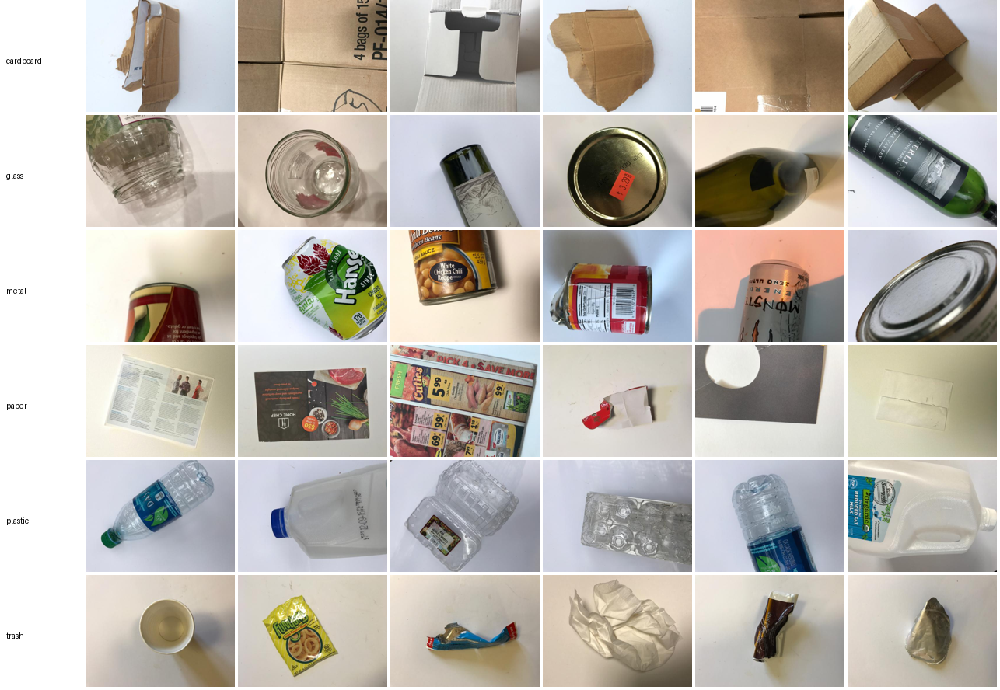
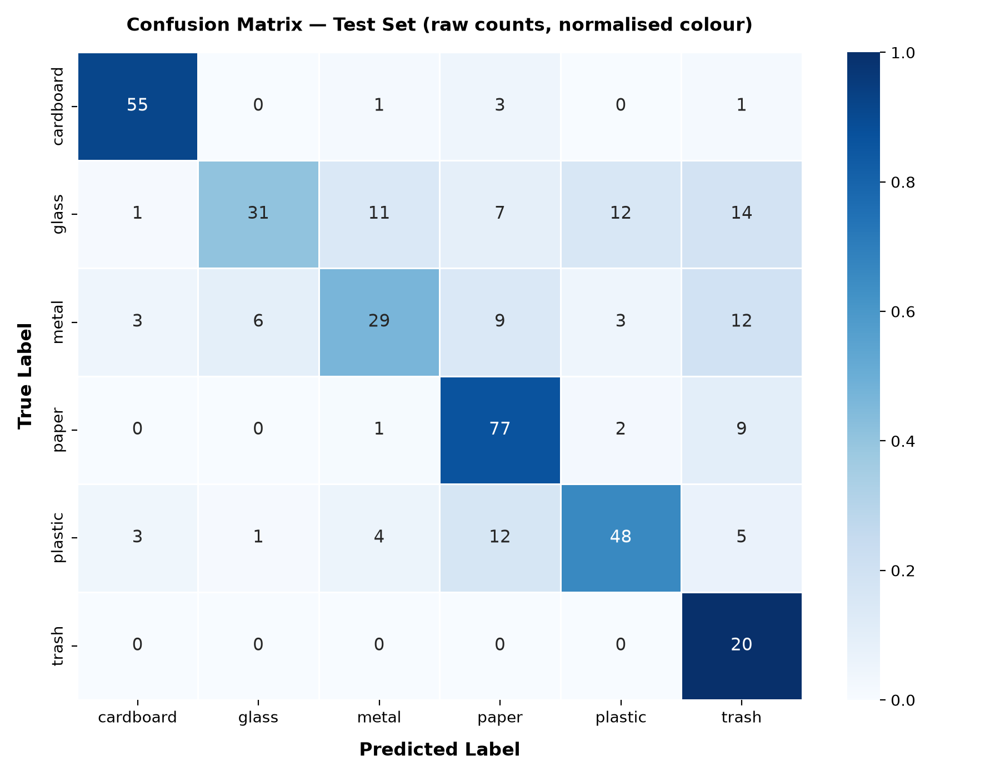
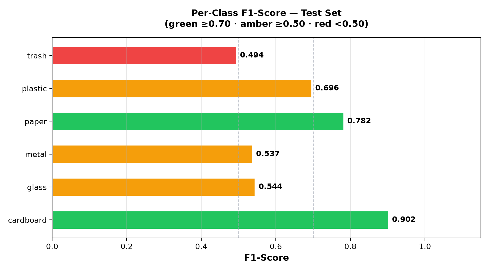
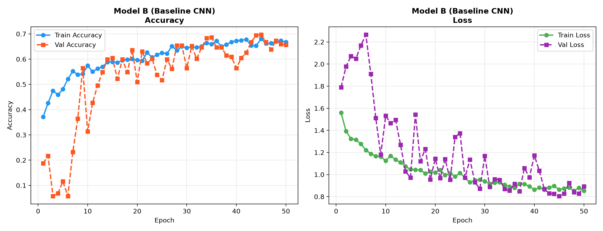

# ♻️ Waste Classification with CNNs

Classifying photos of waste into **6 recycling categories** (cardboard, glass, metal, paper, plastic, trash) with Convolutional Neural Networks built **from scratch** in TensorFlow/Keras, plus a **Streamlit** web app for live predictions.


<p align="center">
  
</p>

---

## Highlights

- **End-to-end ML pipeline:** dataset validation → stratified splitting → training → held-out evaluation → inference app.
- **Data integrity checks:** every image is verified, and SHA-256 hashing detects duplicate images (3 cross-class duplicates found in TrashNet).
- **Class imbalance handling:** inverse-frequency class weights computed from the training split only (the `trash` class has 4× fewer images than `paper`).
- **Two from-scratch CNNs** compared under identical conditions; the model is selected on validation accuracy, and the test set is used **once** for the final score.
- **Efficient input pipeline:** images are loaded lazily with `tf.data` and augmented inside the model graph (training only).
- **Streamlit app** showing the predicted class, confidence and the full probability breakdown.

---

## Results

| Model | Filters | Params | Epochs | Train time (CPU) | Best val acc | Test acc |
|---|---|---|---|---|---|---|
| Model A — Small CNN | 16-32-64 | 28.5K | 50 | 5.5 min | 66.0% | not evaluated* |
| **Model B — Baseline CNN** | 32-64-128 | 111K | 50 | 15.7 min | **69.7%** | **68.4%** |

\* Model B was selected on validation accuracy, so only Model B was run on the held-out test set.

**Per-class test results (Model B, 380 test images):**

| Class | Precision | Recall | F1 | Support |
|---|---|---|---|---|
| cardboard | 0.89 | 0.92 | **0.90** | 60 |
| paper | 0.71 | 0.87 | 0.78 | 89 |
| plastic | 0.74 | 0.66 | 0.70 | 73 |
| glass | 0.82 | 0.41 | 0.54 | 76 |
| metal | 0.63 | 0.47 | 0.54 | 62 |
| trash | 0.33 | 1.00 | 0.49 | 20 |
| **macro avg** | 0.69 | 0.72 | 0.66 | 380 |

<p align="center">
  
  
</p>

### Analysis

- **Cardboard and paper are easy.** They have a distinctive colour and texture (cardboard pixels average much more red than blue).
- **Glass and metal are hard.** Glass is confused with plastic, metal and trash: reflective, transparent surfaces lose detail at 128×128.
- **Trash is over-predicted.** The minority class weight (≈3.07×) gives perfect trash recall but only 33% precision. Tuning these weights is the next experiment.
- **The models underfit rather than overfit.** Training and validation accuracy are both about 65–70% and still rising at epoch 50. Each output feature of the 3-block CNN only "sees" about a 22×22 pixel patch (its receptive field), so the models learn colour and texture but not whole-object shape. That motivates a deeper architecture (see [Roadmap](#roadmap)).

<p align="center">
  
</p>

---

## Dataset

[**TrashNet**](https://github.com/garythung/trashnet) (Thung & Yang, 2016): 2,527 RGB photos of single waste items on a plain background, resized to 512×384.

| Class | Images | Share |
|---|---|---|
| paper | 594 | 23.5% |
| glass | 501 | 19.8% |
| plastic | 482 | 19.1% |
| metal | 410 | 16.2% |
| cardboard | 403 | 16.0% |
| trash | 137 | 5.4% |

**Stratified split (seed 42):** train 1,768 (70%) / validation 379 (15%) / test 380 (15%). Split files are in [`data/splits/`](data/splits).

**Integrity:** 0 corrupt images. 3 identical images appear under two different labels (glass↔metal, glass↔plastic ×2). They were kept and documented as label noise. Full report: [`results/reports/dataset_validation_report.txt`](results/reports/dataset_validation_report.txt).

---

## Model Architecture

Both models share the same design and differ only in width:

```
Input (128×128×3, uint8)
 → Rescaling (÷255)
 → Augmentation — training only: flip, rotate ±27°, zoom ±15%, brightness ±20%, contrast ±20%
 → [Conv2D 3×3 → BatchNorm → ReLU → MaxPool 2×2] × 3
 → GlobalAveragePooling2D
 → Dense (ReLU) → Dropout
 → Dense(6, Softmax)
```

| | Model A | Model B |
|---|---|---|
| Conv filters | 16 → 32 → 64 | 32 → 64 → 128 |
| Dense units | 64 | 128 |
| Dropout | 0.3 | 0.4 |
| Parameters | 28,470 | 111,206 |

**Training setup:** Adam (lr 1e-3), sparse categorical cross-entropy, batch size 32, up to 50 epochs, EarlyStopping (patience 8, restores best weights), ReduceLROnPlateau (×0.5, patience 4), class weights.

Rescaling and augmentation live inside the model, so the saved `.keras` file takes raw images and needs no extra preprocessing at inference time.

---

## Project Structure

```
waste-classification-cnn/
├── app.py                     # Streamlit web app
├── requirements.txt
├── src/
│   ├── config.py              # paths, classes, hyperparameters
│   ├── data_preparation.py    # validation, duplicate detection, stratified splits
│   ├── model.py               # Model A & Model B definitions (+ smoke test)
│   ├── train.py               # training loop, curves, validation confusion matrix
│   ├── evaluate.py            # final test-set evaluation
│   └── predict.py             # reusable single-image inference
├── data/splits/               # train / val / test CSVs (file paths + labels)
├── models/                    # trained .keras models, histories, class labels
├── results/
│   ├── plots/                 # distribution, samples, curves, confusion matrices
│   └── reports/               # dataset report, classification report, experiment table
└── docs/
    └── transfer_learning_plan.md
```

---

## Getting Started

### 1. Set up the environment (Python 3.12)

```bash
git clone https://github.com/Utsav-tala/waste-classification-cnn.git
cd waste-classification-cnn
python3.12 -m venv .venv
source .venv/bin/activate
pip install -r requirements.txt
```

### 2. Run the app (trained models are included)

```bash
streamlit run app.py
```

Upload a JPG/PNG/WEBP photo of a waste item and click **Classify Waste**.

### 3. Reproduce training (optional)

The dataset is not stored in this repo. Download `dataset-resized.zip` from the [TrashNet repository](https://github.com/garythung/trashnet/tree/master/data) and unzip it into the project root so you have `dataset-resized/<class>/*.jpg`.

```bash
python -m src.data_preparation   # validate data, create splits, plots
python -m src.model              # smoke-test both architectures
python -m src.train              # train Model A and Model B
python -m src.evaluate model_b   # final evaluation on the test set
```

---

## Limitations

- Trained on studio-style photos (one object on a plain background); accuracy on cluttered real-world photos will be lower.
- Only 6 fixed categories; the model cannot say "unknown".
- Softmax confidence is not a calibrated probability.
- Small dataset (1,768 training images) and low input resolution (128×128).

---

## Roadmap

- [ ] **Model C — deeper from-scratch CNN** (residual / VGG-style blocks, larger receptive field, 160×160 input)
- [ ] Tune class weights and add label smoothing to fix trash over-prediction
- [ ] **Transfer learning** (MobileNetV2, EfficientNetB0) as a comparison baseline. See [`docs/transfer_learning_plan.md`](docs/transfer_learning_plan.md)
- [ ] Evaluate all models on an unseen real-world dataset to measure generalisation
- [ ] Model selector in the Streamlit app

---

## Acknowledgements

- Dataset: [TrashNet](https://github.com/garythung/trashnet) by Gary Thung and Mindy Yang.
- Developed as an Independent Project (IP) on Neural Networks under the guidance of Prof. Pushpendra Kumar.

## License

[MIT](LICENSE)
